# Før og etter: visuelt løft (m10)

Før = docs/screens/m8 (mobilaktig enkeltkolonne med toppmeny). Etter = denne grenen, 1280 px bredt vindu (Chromium, nb, lys), unntatt der annet er angitt. Skjermbildene er fra Chromium, ikke fra Windows/WebView2.

## Hjem
| Før (m8) | Etter (m10, 1280) |
|---|---|
| 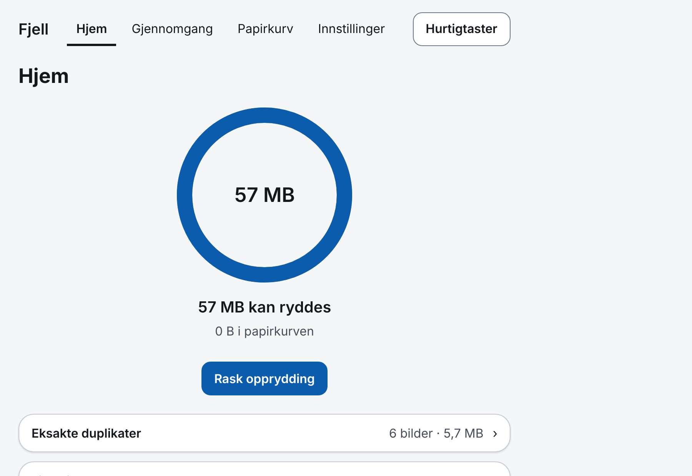 | 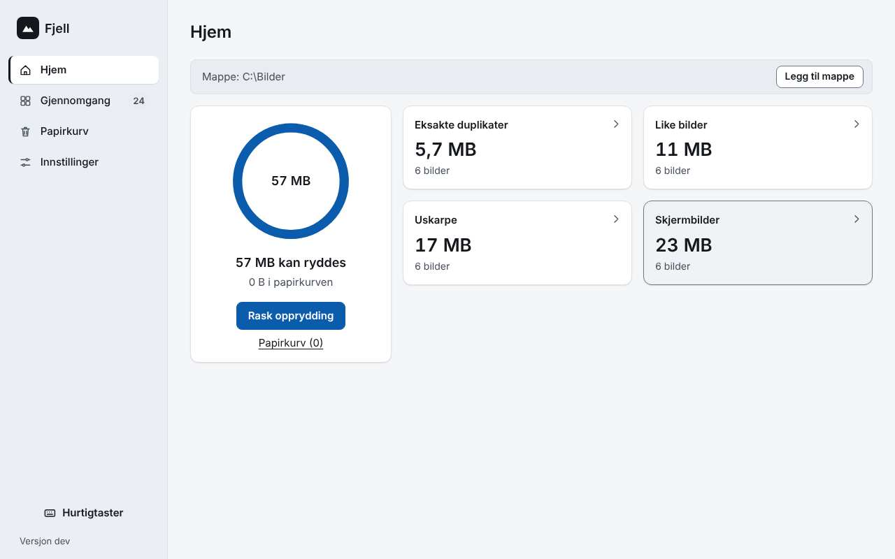 |

Smal (480 px, toppmeny): 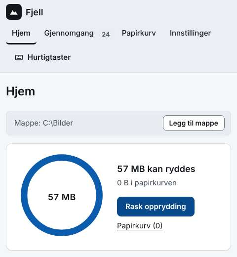

## Innstillinger
| Før (m8) | Etter (m10, 1280) |
|---|---|
| 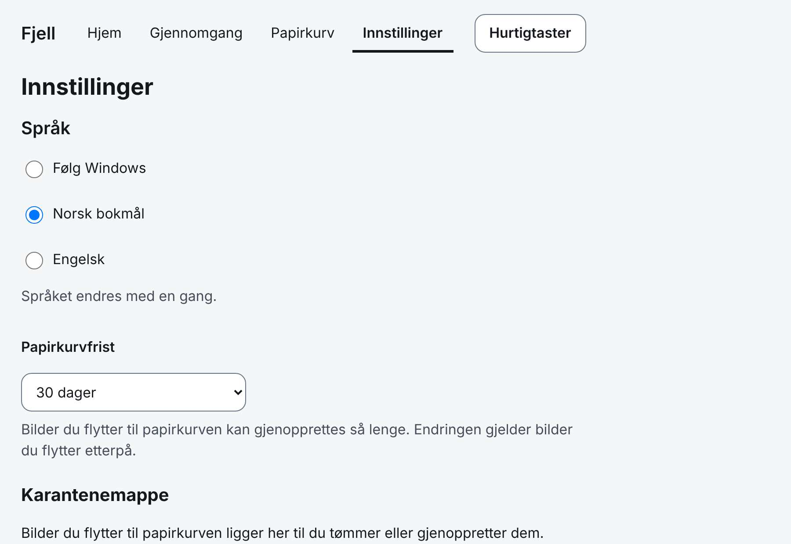 | 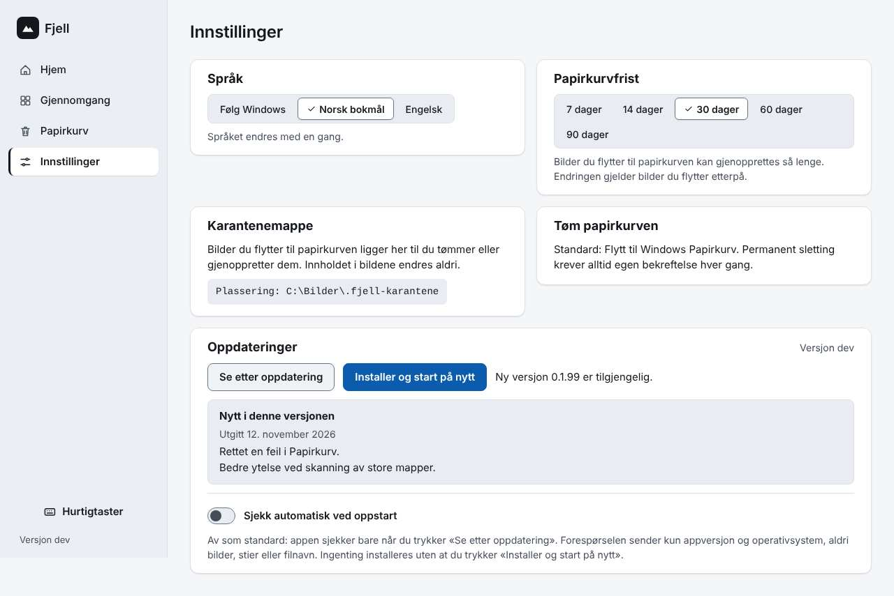 |

## Papirkurv
| Før (m8) | Etter (m10, 1280) |
|---|---|
| 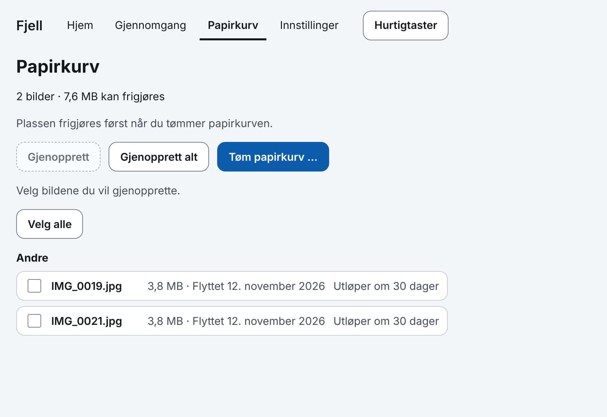 | 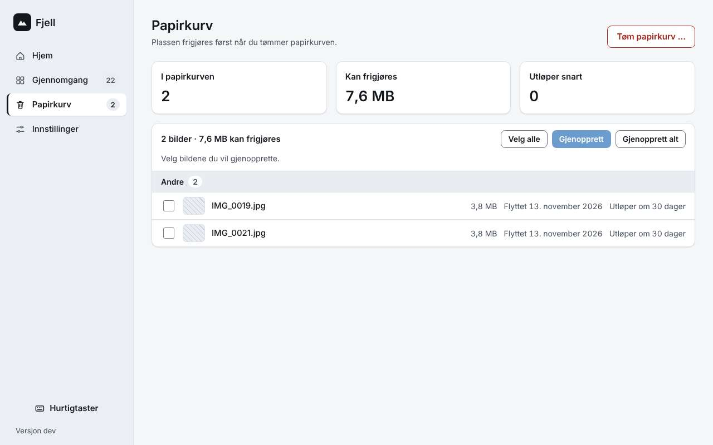 |

Ved 800 px (toppmeny): 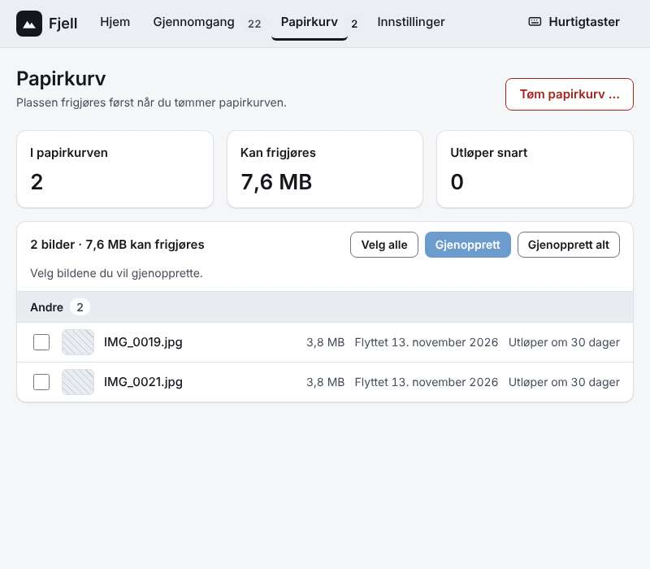

## Gruppe (sammenligning)
Gruppevisningen finnes ikke i m8. Etter (1280): 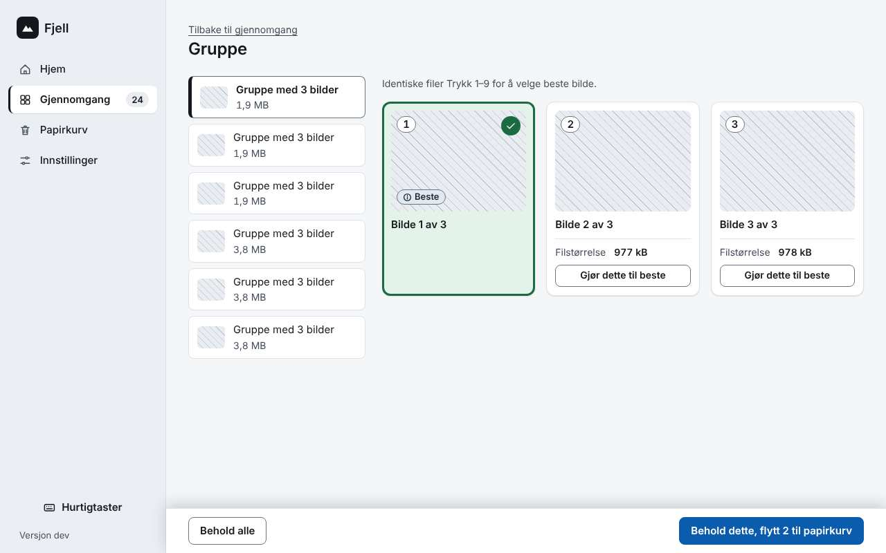

## Gjennomgang og Kortmodus
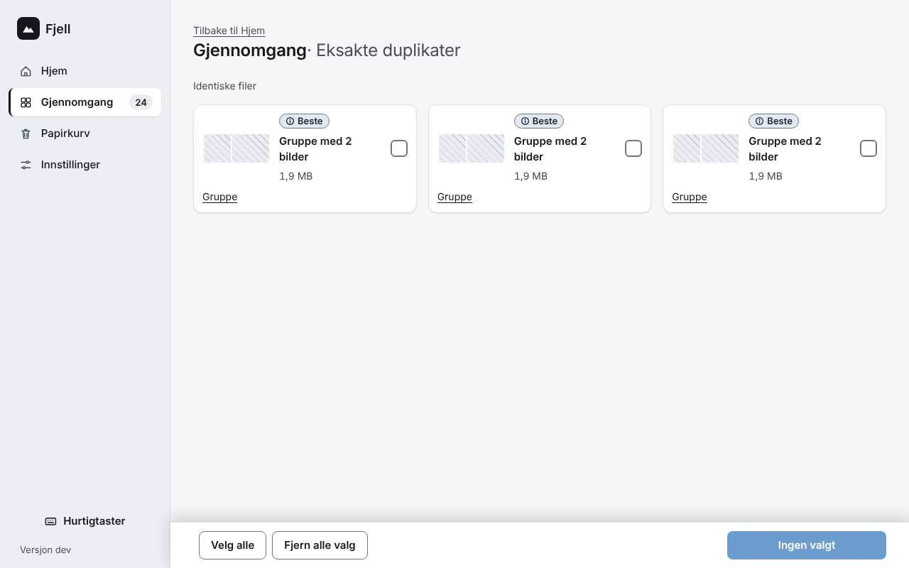 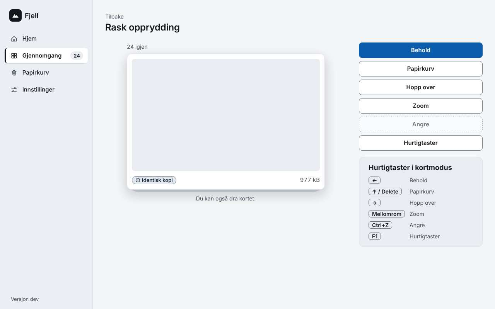
